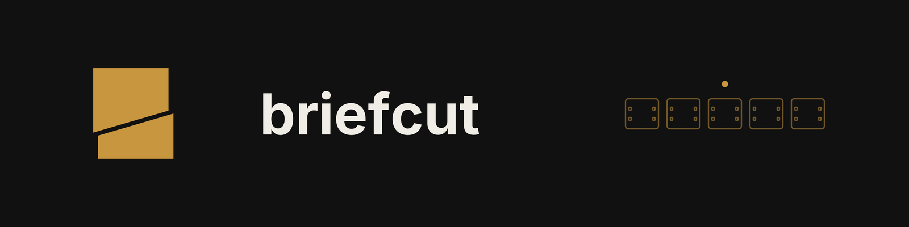
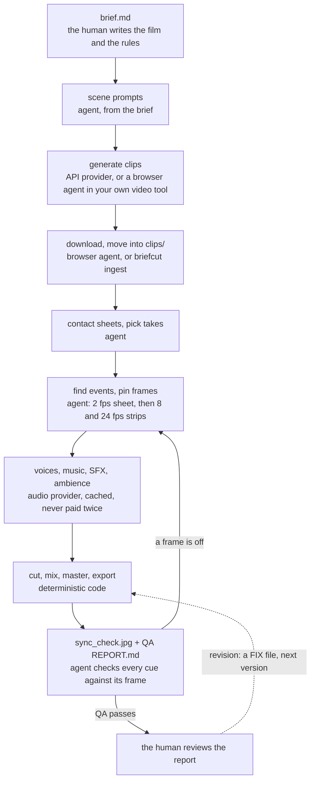
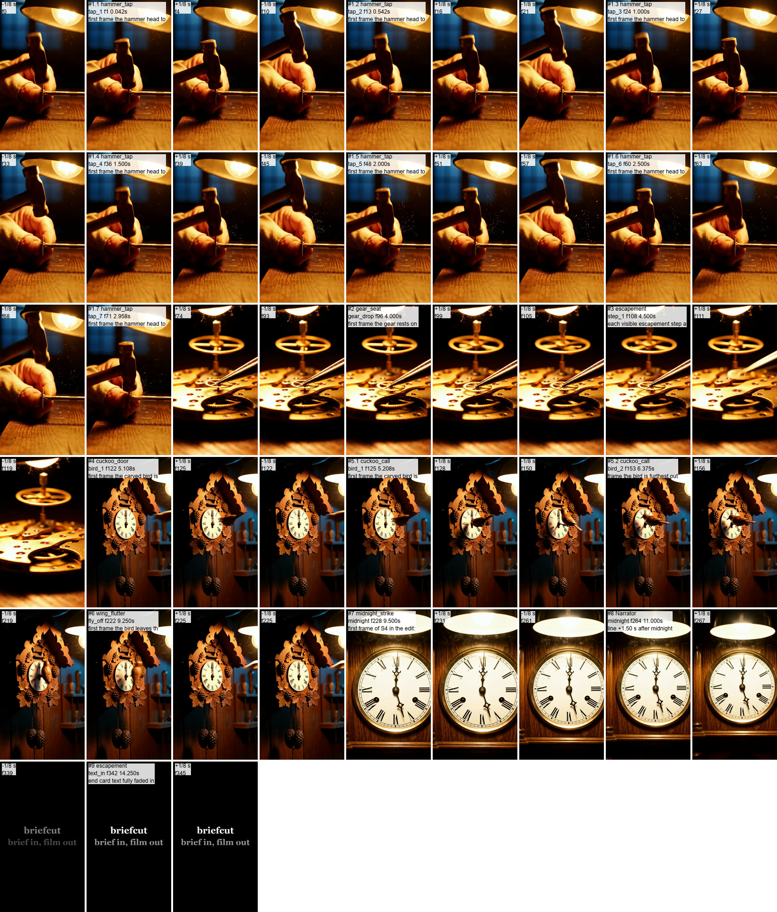

https://github.com/user-attachments/assets/5b25ed60-a413-474a-99e2-da2e01ded3ba

<p align="center"><sub>Midnight, 15.5 s with sound, rendered by briefcut from four generated clips and a markdown brief. No player? <a href="media/midnight-preview.gif">Silent GIF of the last 7.75 s</a> or <a href="media/midnight-preview.mp4">the mp4</a>.</sub></p>

**Brief in, film out.** A markdown brief goes in; generated clips, voices, music and sound
effects are assembled by deterministic code into a frame-synced, loudness-normalized film with a
QA report. Coding and browser agents do the parts code can't: producing clips in a video tool,
and looking at the pictures.

[](https://github.com/cagrikacmaz/briefcut/releases/latest)  

I designed this pipeline (the brief format, the edit, voice and sync rules, the QA checks and the
agent workflow) and it has rendered every film of my kids' learning channel and several client
films. The human writes the brief and the rules and reviews the QA. Agents execute.

## The loop



```
brief.md
  -> scene prompts (flow_brief.md)            agent writes from the brief
  -> generate clips                            API provider, or a browser agent in the user's own video tool
  -> download 1080p + move into clips/         browser agent / `briefcut ingest --from <Downloads> --since`
  -> contact sheets, pick takes                agent looks at 2 fps sheets, writes clips/NOTES.md
  -> find events, pin frames                   agent: 2 fps sheet -> 8 fps strips -> cues.md
  -> voices, music, SFX, ambience              audio provider, cached, never paid twice
  -> cut, mix, master, export                  deterministic code
  -> sync_check.jpg + QA REPORT.md             agent verifies every cue against its frame, iterates
```

Principles: the brief is the single source of truth. Runs are unattended: decisions go to
`OPEN_QUESTIONS.md`, never questions. QA can say FAIL, and the FAIL stays in the report. Paid
generations are cached and estimated before spending. Agents only look at small sheets, never
full frames or whole videos. Clips are never sped up, slowed, frozen or reversed unless the brief
says so. Details: [docs/RULES.md](docs/RULES.md).

## How Midnight was made

Midnight is a 15.5 s vertical film about a clockmaker's workshop at night: hammer taps on brass,
a gear seating, a cuckoo, and every clock striking midnight. The full build log is in
[`examples/midnight/`](examples/midnight/): brief, two revisions, take notes, cue sheet, strips,
sheets, voice audition, reports and every decision. Clips, audio and masters are not in git; the masters are
attached to the v0.1.0 release.

1. **I wrote the film idea, the rules, the brief format and the QA checks.** The scene prompts
   ([`FLOW_BRIEF.md`](examples/midnight/FLOW_BRIEF.md)) and the production brief
   ([`BRIEF.md`](examples/midnight/BRIEF.md)) follow from them.
2. **A browser agent produced the clips in Google Flow, in my own session**, following
   [`playbooks/flow-browser-agent.md`](playbooks/flow-browser-agent.md): 9:16, Veo 3.1 Quality,
   8 s, 2 takes per prompt, 4 prompts; 7 takes downloaded as 1080p upscales (one did not
   download); 4 used and 3 rejected (one for a film-sprocket overlay at 3.5 s), with reasons in
   [`clips/NOTES.md`](examples/midnight/clips/NOTES.md). About 800 Flow credits. All seven take
   sheets: [`media/take-sheets.jpg`](media/take-sheets.jpg).
3. **A coding agent ran briefcut unattended.**
   - **Events.** 2 fps sheets, then 8 and 24 fps strips (22 strips, all in
     [`out/strips/`](examples/midnight/out/strips/)), written to
     [`out/cues.md`](examples/midnight/out/cues.md) with how each frame was found. The strips
     found what the sheets hid: the hammer does not tap three times, it taps every 11-12 frames,
     which a 2 fps sheet (one tile every 12 frames) shows as a still hammer. All seven taps in the
     shot got a sound, recorded in [`OVERRIDES.md`](examples/midnight/OVERRIDES.md).
   - **Deviations, flagged on top of the report.** No discrete escapement step is visible (the
     balance wheel turns continuously, out of focus), so the tick sits on the music's beat; the
     clock's hands never meet at XII, so the strike lands on the hard cut to the dial, as the
     brief planned.
   - **Audio.** [`out/COST.md`](examples/midnight/out/COST.md) before any call: 16 requests,
     2,174 ElevenLabs credits. ElevenLabs made 16 generations in 41 s: 1 narrator line
     (18 characters, voice "George", the brief's first candidate), 12 sound-effect variants,
     2 music takes (take 1 kept: steadiest tempo, 120.00 BPM, local spread 0.04 BPM against 0.15)
     and 1 ambience bed. Every later render reused the cache; the first revision made no paid call.
   - **Sync.** The first render put a two-part door clack, a cuckoo call and a wing flutter
     1.2-2.1 frames off, which led to placing effects by their attack point. Since then every
     sound measures 0.00 frames from its target in the master (tolerance ±1), and every row of
     `sync_check.jpg` was checked by eye.
4. **I reviewed the result and asked for a revision** (v2: ending energy, a tighter cut, social
   loudness). In v1 the last seconds before the end card fell to -42.57 LUFS momentary, 35 LU
   under the strike; S2 and S4 held near-static frames; the end card's second line was small on
   a phone; LinkedIn and X do not normalize loudness. The revision is one file,
   [`FIX01.md`](examples/midnight/FIX01.md): each section replaces the brief's section of the same
   name, the render is `_v2`, and v1 stays as delivered ([`out/v1/`](examples/midnight/out/v1/)).
   It holds the strike's own decay to fall no faster than 1.2 dB/s and ducks it 4 dB under the
   narrator, raises the narrator 3 dB and starts it at strike + 1.5 s, runs the ambience through
   the end card, puts one soft tick on the frame the card text settles, trims S2 to 2.0 s and S4
   to 4.5 s, makes the card 1.5 s with its second line at 104 px instead of 50, and adds
   -10 LUFS social masters. briefcut gained the options to say this in a brief (row gain, held
   decay, effect duck, end-card line size, a second loudness target per export, an ending-energy
   QA row). The first v2 renders failed in two places. The tail dipped 9.35 LU under the strike
   just after the line, fixed with a slower held decay and the music's 4 dB duck. The social
   masters overshot the true-peak limit after AAC encoding, and one render that read -1.0 dBTP
   had a sample peak of -0.97 dBFS; the true-peak rule now counts the sample peak, and the social
   masters settled at a -4.5 dBTP limiter ceiling.
5. **I reviewed v2 and asked for a deeper, clearer narrator** (v3, audio only, picture as v2):
   [`FIX02.md`](examples/midnight/FIX02.md). The narrator is chosen by audition: the line
   generated with four voices (4 lines, 72 characters, 72 ElevenLabs credits), each measured for its
   fundamental and spectral centroid; Adam is lowest on both (90.1 Hz, 1424 Hz), see
   [`out/AUDITION.md`](examples/midnight/out/AUDITION.md). The line is at -3 dBFS peak with a +2 dB
   low shelf at 150 Hz, and the strike is ducked 6 dB under it (150 ms attack, 600 ms release).
   With that alone the line measured 1.09 dB under the bell in the speech band (300-3000 Hz, what
   a phone speaker reproduces), so the strike is ducked 18 dB more in that band only, with a fast
   attack and release, and the narrator is compressed 6:1 so the end of the line holds up. Now the
   line is 6.44 dB over the bell in that band and the ending rule still holds (7.15 LU). Every
   sound and `sync_check.jpg` are unchanged from v2.
   - **Runtime.** Audio 41 s (v1) and 4 audition lines (v3). A v3 cut with all five exports takes
     55 s; a regression re-render in a mirror folder was frame-identical (372 of 372 frames) and
     bit-identical in audio.

QA of v3, from [`out/REPORT.md`](examples/midnight/out/REPORT.md):

| # | Check | Result | Detail |
|---|---|---|---|
| 1 | Duration 15.5-16.5 s | PASS | 15.500 s, 372 frames |
| 2 | Master: -14 LUFS ±0.5, true peak ≤ -1 dBTP, no clipping | PASS | -14.00 LUFS, -1.40 dBTP, sample peak -1.43 dBFS |
| 3 | Every event and cue placed or logged | PASS | 16 placed, 0 dropped, 1 event flagged not found |
| 4 | Every sound within ±1 frame, measured on the master | PASS | worst 0.00 frames over 16 sounds |
| 5 | Music silent after the hard stop | PASS | digital silence from 9.520 s |
| 6 | The midnight strike is the loudest moment (400 ms momentary) | PASS | -8.94 LUFS at 9.80 s, strike at 9.50 s |
| 7 | `MIDNIGHT_social_v3.mp4`: -10 LUFS ±0.5, true peak ≤ -1 dBTP, no clipping | PASS | -10.00 LUFS, -1.10 dBTP, sample peak -1.12 dBFS |
| 8 | `MIDNIGHT_16x9_social_v3.mp4`: the same | PASS | -10.00 LUFS, -1.10 dBTP, sample peak -1.12 dBFS |
| 9 | The narrator reads over the strike: speech band 300-3000 Hz at least 6 dB above it | PASS | +6.44 dB in the line's window |
| 10 | Last 3 s before the end card within 8 LU of the strike | PASS | lowest -16.09 LUFS at 12.10 s, 7.15 LU under the strike |
| 11 | First sound within 0.5 s | PASS | first tap at 0.042 s |
| 12 | First frame not black, last frame is the end card | PASS | |
| 13 | No audio from the source clips | PASS | |
| 14 | Hard cuts only, no retiming | PASS | render graph checked |
| 15 | Min shot 2.0 s | PASS | shortest 2.000 s |
| 16 | Cuts on the music grid | PASS | worst 0.14 ms off a beat |
| 17 | No silence holes | PASS | |

## What `sync_check.jpg` proves

<p align="center"></p>

Every row is one sound, cut from the rendered master, not from the source clips: the frame under
the start of the sound, with the frame 1/8 s before and 1/8 s after, labelled with the cue, its
frame number and what the frame must show. In the hammer rows the middle frame has the head on the
gear and the left frame has the hammer in the air; the bird row shows the bird leaning out on its
call; the strike row is the first frame of the dial after the cut. If a frame does not show its
moment, the cue is wrong, and the agent fixes it and renders again. The numbers in the report say
where the sound is; this sheet says the picture agrees.

## Quickstart (no key, under a minute)

```bash
npx github:cagrikacmaz/briefcut demo
```

Or from a clone:

```bash
git clone https://github.com/cagrikacmaz/briefcut && cd briefcut && node bin/briefcut.mjs demo
```

The demo renders [`examples/hello-short`](examples/hello-short/BRIEF.md) with mock providers:
test-pattern clips that flash white on known frames, tones with 0.3 s of leading silence, a click
track at 120 BPM. It runs the whole loop and prints the QA result (16-20 s on a laptop). Needs
Node.js 22+ and ffmpeg (found through `FFMPEG_DIR`, `PATH`, or WinGet on Windows).

## Your own footage

briefcut does not need generated clips. It was built on client films that mixed shot footage with
generated scenes, and every step after `generate` treats a camera file like any other clip.

- Put your clips in `clips/`, named by the brief's scene ids (`clips/S1_ARRIVAL.mov` or
  `clips/S1.mp4` for scene `S1_ARRIVAL`). Stills (`.jpg`, `.png`, `.webp`, `.tif`) work too: a
  still becomes a held shot, exactly as long as its EDL row or cue sheet says.
- To pull footage in from a camera card or a download folder, `briefcut ingest` copies every video
  file and still into `clips/_takes/` and writes `INGEST.md` (size, frame rate, frames, colour tags,
  duplicates set aside); then copy the chosen take of each scene to `clips/<SCENE>.<ext>`:

  ```bash
  briefcut ingest my-film --from <folder>
  ```

- Skip `prompts` and `generate`, and run the rest as usual:

  ```bash
  briefcut sheets my-film
  briefcut prepare my-film --max-spend 2
  briefcut cut my-film --offline
  ```

A clip that is not at the film's size or frame rate is conformed at the cut and logged; nothing is
upscaled or retimed. Camera audio is not used: the mix is built from the brief's voices, effects,
music and ambience.

## Make your own film

```bash
briefcut init my-film          # BRIEF.md template, clips/, out/, .env.example
```

Write the brief ([format](docs/BRIEF_FORMAT.md)), put your ElevenLabs key in `my-film/.env` (copy `.env.example`),
then choose how clips are made:

**API provider** (`Video provider: higgsfield`, `fal` or `gemini-omni` in the brief):

```bash
briefcut estimate my-film
briefcut generate my-film --takes 2 --max-spend 5
```

**Browser-agent handoff** (`Video provider: handoff`, for tools without an API such as Google
Flow): `briefcut prompts my-film` writes `flow_brief.md`; you, or a browser agent you supervise in
your own logged-in account, generate and download the takes
([playbook](playbooks/flow-browser-agent.md)); then

```bash
briefcut ingest my-film --from ~/Downloads --since 30m
```

Then, either way:

```bash
briefcut sheets my-film --takes       # look, choose, write clips/NOTES.md
briefcut sheets my-film               # sheets of the chosen clips
briefcut strip my-film S1 0.75 --fps 8   # and --fps 24, then write out/cues.md
briefcut estimate my-film
briefcut prepare my-film --max-spend 2
briefcut cut my-film --offline        # look at out/sync_check.jpg, fix cues, repeat
```

All commands: `briefcut help`. Flags: `--offline`, `--mock`, `--max-spend <usd>`,
`--brief <file>`, `--preset <name>`.

## The brief, in short

```
## Audio map
| Scene | Track | Voice | Text | At event | Offset | Gain |
|---|---|---|---|---|---|---|
| S1_HAMMER | A3 | sfx:hammer_tap | | tap_1, tap_2, tap_3 | 0.00 | |
| S2_GEARS | A3 | sfx:escapement | | step_* (every one) | 0.00 | |
| S4_MIDNIGHT | A3 | sfx:midnight_strike | | midnight | 0.00 | |
| S4_MIDNIGHT | A2 | Narrator | `Right on the hour.` | midnight | 1.50 | +3 |
| END_CARD | A3 | sfx:escapement | | text_in | 0.00 | -4 |

## Music and ambience
- Music (A4): `tense ticking music box and pizzicato strings, 120 BPM, instrumental only, 20 seconds`. Two takes, keep the one whose tempo is steadiest.
- Hard stop: the music ends on the `midnight` event (20 ms fade).
```

A brief also has the goal, shot rules, scenes, EDL, event detection table, voices, SFX table,
mix levels, end card, export and QA sections. A revision after review is a FIX file: each of its
sections replaces the brief's section of the same name, and the next render is `_v2`. Full
reference: [docs/BRIEF_FORMAT.md](docs/BRIEF_FORMAT.md).

## Providers

| Provider | Kind | Supports | Billing | Status |
|---|---|---|---|---|
| ElevenLabs | audio | TTS, SFX, music, forced alignment, speech-to-text, voice design | prepaid plan | live (Midnight) + contract tested |
| local | audio | your own files | free | interface tested |
| handoff | video | any web tool, via a browser agent or by hand | the tool's credits | live (Midnight, Google Flow) |
| Higgsfield | video | Seedance 2.0, Kling 3.0 and more, one key | prepaid USD per job | contract tested |
| Gemini API | video | gemini-omni-1.1-flash (Veo 3.1 preview IDs were shut down on 2026-10-22) | pay as you go | contract tested |
| fal | video | Seedance 2.0 queue | prepaid USD per second | contract tested |
| mock | both | deterministic test media | free | demo and golden test |

Contract tested = every request checked against recorded responses in the documented shapes, no
network ([`test/providers.test.mjs`](test/providers.test.mjs)). Endpoints, limits and what is not
supported: [docs/PROVIDERS.md](docs/PROVIDERS.md).

## Agents

[`AGENTS.md`](AGENTS.md) is the operating manual any coding agent reads first. The playbooks are
the procedures:
[browser agent in a video tool](playbooks/flow-browser-agent.md),
[take selection](playbooks/take-selection.md),
[event detection](playbooks/event-detection.md). The order of work and the files that carry state
between agents: [docs/AGENT_WORKFLOW.md](docs/AGENT_WORKFLOW.md).

briefcut ships no code that automates a consumer web app: no browser scripts against video tools,
no private endpoints, no CAPTCHA handling, no cookie or profile copying. The handoff playbook is
instructions for an agent that you supervise, in your own account, at your own discretion.

## Lessons

[docs/LESSONS.md](docs/LESSONS.md) lists 70 failure modes my production runs hit, each as symptom,
cause, rule and check. Five of them:

- Voices landed 0.1-0.6 s late -> generated audio carries leading silence; place the onset, never the file start.
- Stitched song vocals jumped in voice and room -> a song is one production, played sample for sample.
- A loud hit buried the line after it -> a hit and a line never start together; the line waits for a protected window.
- Cues were off by frames on the master though correct on the sheets -> check sync from the master, and pin frames at 8 and 24 fps, not 2.
- An agent "improved" footage with an upscale and a frame-rate change -> anything the brief does not ask for is not done, and the render graph is checked.

## What this is not

- Not a video model. It uses yours, through an API or your own account.
- Not a browser automation tool for consumer web apps.
- Not a general editor: hard cuts on frames the brief and the agent decide, no timeline UI.
- Not a guarantee that generated clips match their prompts. When they don't, the report says so.

## Tests

```bash
npm test
```

62 tests, offline, mock providers, no network: the brief parser and FIX passes, EDL frame math,
beat snap, voice rules, onset and transient trims, loudness math, wildcard events, the music hard
stop, held decay, effect and speech-band ducking, voice audition, stills as held shots, song-block bit identity, provider
contracts, a golden demo render (every sound within ±1 frame of its known flash, the master at
-14 ±0.5 LUFS and a social pair at -10 ±0.5 LUFS, true peak ≤ -1 dBTP), and a privacy scan for
names, local paths, anything that looks like a key, and assistant or model brands, image and video metadata included. CI runs them on Linux, Windows and macOS.

## Acknowledgements

Parts of this pipeline were developed during R&D work with [Selfmades](https://selfmades.co), where
I serve as Strategic Partner and Executive Advisor, and tested in the Selfmades Academy content
program. Thanks to the team there.

If briefcut saves you time, you can support the work at buymeacoffee.com/cagrikacmaz.

## License

MIT, Copyright (c) 2026 Çağrı Kaçmaz. See [LICENSE](LICENSE).
