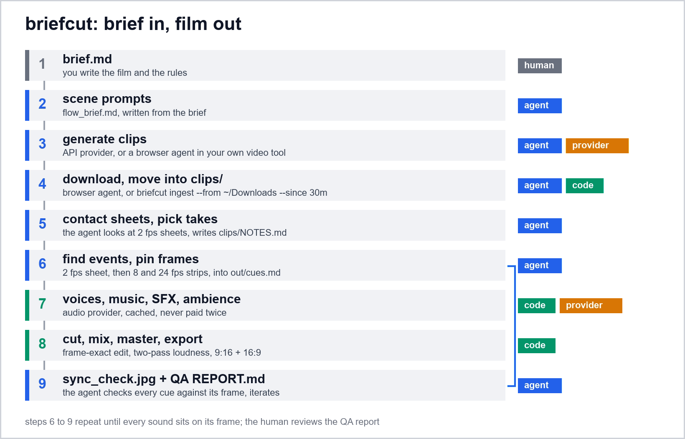

<p align="center">
  <a href="media/midnight-preview.mp4"></a>
  <br><sub>Midnight, last 7.75 s (silent GIF; <a href="media/midnight-preview.mp4">mp4 with sound</a>). Rendered by briefcut from four generated clips and a markdown brief.</sub>
</p>

# briefcut

**Brief in, film out.** A markdown brief goes in; generated clips, voices, music and sound
effects are assembled by deterministic code into a frame-synced, loudness-normalized film with a
QA report. Coding and browser agents do the parts code can't: producing clips in a video tool,
and looking at the pictures.

  

I designed this pipeline (the brief format, the edit, voice and sync rules, the QA checks and the
agent workflow) and it has rendered every film of my kids' learning channel and several client
films. The human writes the brief and the rules and reviews the QA. Agents execute.

## The loop

<p align="center"></p>

```
brief.md
  -> scene prompts (flow_brief.md)            agent writes from the brief
  -> generate clips                            API provider, or a browser agent in the user's own video tool
  -> download 1080p + move into clips/         browser agent / `briefcut ingest --from <Downloads> --since`
  -> contact sheets, pick takes                agent looks at 2 fps sheets, writes clips/NOTES.md
  -> find events, pin frames                   agent: 2 fps sheet -> 8 fps strips -> cues.md
  -> voices, music, SFX, ambience              audio provider, cached, never paid twice
  -> cut, mix, master, export                  deterministic code
  -> sync_check.jpg + QA REPORT.md             agent verifies every cue against its frame, iterates
```

Principles: the brief is the single source of truth. Runs are unattended: decisions go to
`OPEN_QUESTIONS.md`, never questions. QA can say FAIL, and the FAIL stays in the report. Paid
generations are cached and estimated before spending. Agents only look at small sheets, never
full frames or whole videos. Clips are never sped up, slowed, frozen or reversed unless the brief
says so. Details: [docs/RULES.md](docs/RULES.md).

## How Midnight was made

Midnight is a 17.75 s vertical film about a clockmaker's workshop at night: hammer taps on brass,
a gear seating, a cuckoo, and every clock striking midnight. Everything is in
[`examples/midnight/`](examples/midnight/) except the clips, audio and masters (the masters are
attached to the v0.1.0 release).

1. **I wrote the film idea and the rules.** A coding agent wrote the scene prompts
   ([`FLOW_BRIEF.md`](examples/midnight/FLOW_BRIEF.md)) and the production brief
   ([`BRIEF.md`](examples/midnight/BRIEF.md)) from them.
2. **Clips: a browser agent in my own browser session**, following
   [`playbooks/flow-browser-agent.md`](playbooks/flow-browser-agent.md): a new Google Flow project,
   9:16, Veo 3.1 Quality, 8 s, 2 takes per prompt; 4 scene prompts submitted; 7 takes downloaded as
   1080p upscales (one did not download); moved into the film folder; contact sheets made; 4 takes
   picked, 3 rejected (one for a film-sprocket overlay that appears at 3.5 s); reasons in
   [`clips/NOTES.md`](examples/midnight/clips/NOTES.md). About 800 Flow credits.
   All seven take sheets: [`media/take-sheets.jpg`](media/take-sheets.jpg).
3. **Then a coding agent ran briefcut**, unattended:
   - **Events.** 2 fps sheets, then 8 and 24 fps strips (22 strips, all in
     [`examples/midnight/out/strips/`](examples/midnight/out/strips/)); 19 events in
     [`out/cues.md`](examples/midnight/out/cues.md), 13 pinned to their frames and 6 marked not found,
     each with how it was found. The
     strips found what the sheets hid: the hammer does not tap three times, it taps every 11-12
     frames, which a 2 fps sheet (one tile every 12 frames) shows as a still hammer. All seven taps
     in the shot got a sound, recorded in [`OVERRIDES.md`](examples/midnight/OVERRIDES.md).
   - **Deviations, flagged on top of the report**: no discrete escapement step is visible (the
     balance wheel turns continuously, out of focus), so the six ticks sit on the music's beats;
     the clock's hands never meet at XII, so the strike lands on the hard cut to the dial, as the
     brief planned.
   - **Audio.** [`out/COST.md`](examples/midnight/out/COST.md) before any call: 16 requests, about
     0.43 USD (2,174 credits). ElevenLabs then made 16 generations in 41 s: 1 narrator line
     (18 characters, voice "George", the brief's first candidate), 12 sound-effect variants,
     2 music takes (take 1 kept: steadiest tempo, 120.00 BPM, local spread 0.04 BPM vs 0.15) and
     1 ambience bed. Every later render reused the cache.
   - **Sync.** 20 sounds placed; measured in the master, every one sits 0.00 frames from its
     target (tolerance ±1), and every row of `sync_check.jpg` was checked by eye. Three iterations:
     the first render put a two-part door clack, a cuckoo call and a wing flutter 1.2-2.1 frames
     off, which led to placing effects by their attack point (see the
     [report](examples/midnight/out/REPORT.md)).
   - **Decisions**: 11 written down, 4 by briefcut and 7 by the agent, in
     [`OPEN_QUESTIONS.md`](examples/midnight/OPEN_QUESTIONS.md).
   - **Runtime**: audio 41 s, cut and export 49 s. A regression re-render in a mirror folder was
     frame-identical (426 of 426 frames) and bit-identical in audio.

QA, from [`out/REPORT.md`](examples/midnight/out/REPORT.md):

| # | Check | Result | Detail |
|---|---|---|---|
| 1 | Duration 15-20 s | PASS | 17.750 s, 426 frames |
| 2 | Loudness -14 LUFS ±0.5, true peak ≤ -1 dBTP, no clipping | PASS | -14.00 LUFS, -1.30 dBTP, measured on the exported AAC |
| 3 | Every event and cue placed or logged | PASS | 20 placed, 0 dropped, 7 events flagged not found |
| 4 | Every sound within ±1 frame, measured on the master | PASS | worst 0.00 frames over 20 sounds |
| 5 | Music silent after the hard stop | PASS | digital silence from 11.020 s |
| 6 | The midnight strike is the loudest moment (400 ms momentary) | PASS | -7.42 LUFS momentary at 11.30 s, strike at 11.00 s |
| 7 | First sound within 0.5 s | PASS | first tap at 0.042 s |
| 8 | First frame not black, last frame is the end card | PASS | |
| 9 | No audio from the source clips | PASS | |
| 10 | Hard cuts only, no retiming | PASS | render graph checked |
| 11 | Min shot 2.0 s | PASS | shortest 3.000 s |
| 12 | Cuts on the music grid | PASS | worst 0.16 ms off a beat |
| 13 | No silence holes | PASS | |

## What `sync_check.jpg` proves

<p align="center"></p>

Every row is one sound, cut from the rendered master, not from the source clips: the frame under
the start of the sound, with the frame 1/8 s before and 1/8 s after, labelled with the cue, its
frame number and what the frame must show. In the hammer rows the middle frame has the head on the
gear and the left frame has the hammer in the air; the bird row shows the bird leaning out on its
call; the strike row is the first frame of the dial after the cut. If a frame does not show its
moment, the cue is wrong, and the agent fixes it and renders again. The numbers in the report say
where the sound is; this sheet says the picture agrees.

## Quickstart (no key, under a minute)

```bash
npx briefcut demo
```

Before the npm release, from a clone:

```bash
git clone https://github.com/cagrikacmaz/briefcut && cd briefcut && node bin/briefcut.mjs demo
```

The demo renders [`examples/hello-short`](examples/hello-short/BRIEF.md) with mock providers:
test-pattern clips that flash white on known frames, tones with 0.3 s of leading silence, a click
track at 120 BPM. It runs the whole loop and prints the QA result (16-20 s on a laptop). Needs
Node.js 22+ and ffmpeg (found through `FFMPEG_DIR`, `PATH`, or WinGet on Windows).

## Make your own film

```bash
briefcut init my-film          # BRIEF.md template, clips/, out/, .env.example
```

Write the brief ([format](docs/BRIEF_FORMAT.md)), put your ElevenLabs key in `my-film/.env` (copy `.env.example`),
then choose how clips are made:

**API provider** (`Video provider: higgsfield`, `fal` or `gemini-omni` in the brief):

```bash
briefcut estimate my-film
briefcut generate my-film --takes 2 --max-spend 5
```

**Browser-agent handoff** (`Video provider: handoff`, for tools without an API such as Google
Flow): `briefcut prompts my-film` writes `flow_brief.md`; you, or a browser agent you supervise in
your own logged-in account, generate and download the takes
([playbook](playbooks/flow-browser-agent.md)); then

```bash
briefcut ingest my-film --from ~/Downloads --since 30m
```

Then, either way:

```bash
briefcut sheets my-film --takes       # look, choose, write clips/NOTES.md
briefcut sheets my-film               # sheets of the chosen clips
briefcut strip my-film S1 0.75 --fps 8   # and --fps 24, then write out/cues.md
briefcut estimate my-film
briefcut prepare my-film --max-spend 2
briefcut cut my-film --offline        # look at out/sync_check.jpg, fix cues, repeat
```

All commands: `briefcut help`. Flags: `--offline`, `--mock`, `--max-spend <usd>`,
`--brief <file>`, `--preset <name>`.

## The brief, in short

```
## Audio map
| Scene | Track | Voice | Text | At event | Offset |
|---|---|---|---|---|---|
| S1_HAMMER | A3 | sfx:hammer_tap | | tap_1, tap_2, tap_3 | 0.00 |
| S2_GEARS | A3 | sfx:escapement | | step_* (every one) | 0.00 |
| S4_MIDNIGHT | A3 | sfx:midnight_strike | | midnight | 0.00 |
| S4_MIDNIGHT | A2 | Narrator | `Right on the hour.` | midnight | 1.80 |

## Music and ambience
- Music (A4): `tense ticking music box and pizzicato strings, 120 BPM, instrumental only, 20 seconds`. Two takes, keep the one whose tempo is steadiest.
- Hard stop: the music ends on the `midnight` event (20 ms fade).
```

A brief also has the goal, shot rules, scenes, EDL, event detection table, voices, SFX table,
mix levels, end card, export and QA sections. Full reference: [docs/BRIEF_FORMAT.md](docs/BRIEF_FORMAT.md).

## Providers

| Provider | Kind | Supports | Billing | Status |
|---|---|---|---|---|
| ElevenLabs | audio | TTS, SFX, music, forced alignment, speech-to-text, voice design | prepaid plan | live (Midnight) + contract tested |
| local | audio | your own files | free | interface tested |
| handoff | video | any web tool, via a browser agent or by hand | the tool's credits | live (Midnight, Google Flow) |
| Higgsfield | video | Seedance 2.0, Kling 3.0 and more, one key | prepaid USD per job | contract tested |
| Gemini API | video | gemini-omni-1.1-flash (Veo 3.1 preview IDs were shut down on 2026-10-22) | pay as you go | contract tested |
| fal | video | Seedance 2.0 queue | prepaid USD per second | contract tested |
| mock | both | deterministic test media | free | demo and golden test |

Contract tested = every request checked against recorded responses in the documented shapes, no
network ([`test/providers.test.mjs`](test/providers.test.mjs)). Endpoints, limits and what is not
supported: [docs/PROVIDERS.md](docs/PROVIDERS.md).

## Agents

[`AGENTS.md`](AGENTS.md) is the operating manual any coding agent reads first.
The playbooks are the procedures:
[browser agent in a video tool](playbooks/flow-browser-agent.md),
[take selection](playbooks/take-selection.md),
[event detection](playbooks/event-detection.md). The order of work and the files that carry state
between agents: [docs/AGENT_WORKFLOW.md](docs/AGENT_WORKFLOW.md).

briefcut ships no code that automates a consumer web app: no browser scripts against video tools,
no private endpoints, no CAPTCHA handling, no cookie or profile copying. The handoff playbook is
instructions for an agent that you supervise, in your own account, at your own discretion.

## Lessons

[docs/LESSONS.md](docs/LESSONS.md) lists 66 failure modes my production runs hit, each as symptom,
cause, rule and check. Five of them:

- Voices landed 0.1-0.6 s late -> generated audio carries leading silence; place the onset, never the file start.
- Stitched song vocals jumped in voice and room -> a song is one production, played sample for sample.
- A loud hit buried the line after it -> a hit and a line never start together; the line waits for a protected window.
- Cues were off by frames on the master though correct on the sheets -> check sync from the master, and pin frames at 8 and 24 fps, not 2.
- An agent "improved" footage with an upscale and a frame-rate change -> anything the brief does not ask for is not done, and the render graph is checked.

## What this is not

- Not a video model. It uses yours, through an API or your own account.
- Not a browser automation tool for consumer web apps.
- Not a general editor: hard cuts on frames the brief and the agent decide, no timeline UI.
- Not a guarantee that generated clips match their prompts. When they don't, the report says so.

## Tests

```bash
npm test
```

45 tests, offline, mock providers, no network: the brief parser, EDL frame math, beat snap,
voice rules, onset and transient trims, loudness math, wildcard events, the music hard stop,
song-block bit identity, provider contracts, a golden demo render (every sound within ±1 frame of
its known flash, -14 ±0.5 LUFS, true peak ≤ -1 dBTP), and a privacy scan for names, local paths
and anything that looks like a key. CI runs them on Linux, Windows and macOS.

## License

MIT, Copyright (c) 2026 Çağrı Kaçmaz. See [LICENSE](LICENSE).
